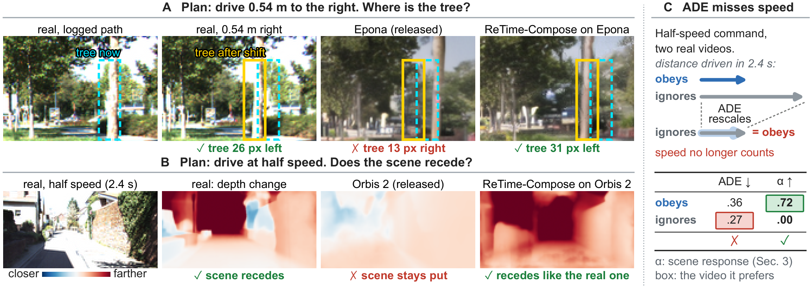
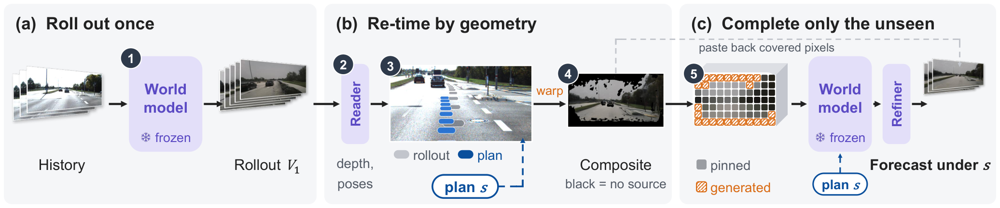

# Driving World Models Move the Camera, Not the Scene

**Yuqiao Feng\*, Xiaoyu Ao\*** · Chongqing University · \*Equal contribution

[Project page](https://joefeng0571.github.io/retime-compose/) · Paper (arXiv, coming soon) · Code (coming soon)



Plan-conditioned driving world models are used to compare candidate plans, so their forecast should change with the plan as the real scene would. Recorded drives already contain the real outcomes of plans that were never driven: retiming a log gives pose-matched images and LiDAR for other speeds, and a stereo rig records a laterally shifted view. Measured against these references, released world models move their camera but barely move the scene. **ReTime-Compose** delivers the plan to a frozen generator as geometry, without training: it transports the frames of one logged-speed rollout to the planned cameras, and the frozen model completes only what no frame covers.



## Release plan

- [x] Project page
- [ ] Paper (arXiv)
- [ ] Scene-response (α) evaluation code and context lists
- [ ] ReTime-Compose inference code

Datasets (KITTI, nuScenes, Argoverse 2) and released world-model checkpoints must be obtained from their original sources under their own licenses; this repository will not redistribute them.

## Citation

```bibtex
@article{retimecompose,
  title   = {Driving World Models Move the Camera, Not the Scene},
  author  = {Feng, Yuqiao and Ao, Xiaoyu},
  journal = {arXiv preprint arXiv:XXXX.XXXXX},
  year    = {2026}
}
```
